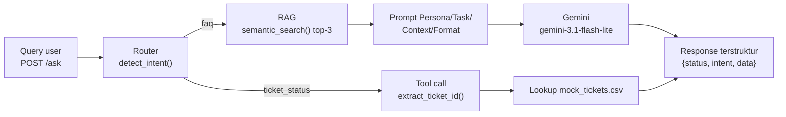

# IT Helpdesk Assistant — Rizky Tria Meditanala

Backend API bertenaga AI untuk menangani pertanyaan karyawan repetitif secara otomatis
dalam satu sistem: **RAG** menjawab pertanyaan kebijakan/informasi dari knowledge base
internal, dan **mini-agent routing** mengenali permintaan yang butuh aksi spesifik
(cek status tiket) lalu menanganinya lewat tool call — dibungkus FastAPI dan dijalankan
dalam container Docker.

## Problem Statement

### Objective

Tim People & IT Operations menerima ratusan pertanyaan repetitif setiap hari: sebagian
berupa pertanyaan kebijakan umum ("berapa jatah cuti saya?", "bagaimana cara reset
password VPN?"), sebagian lagi permintaan spesifik yang butuh pengecekan data langsung
("apa status tiket TICKET-0042 saya?"). Assignment ini membangun prototype backend API
yang menangani kedua jenis permintaan tersebut **dalam satu sistem**: menjawab
pertanyaan kebijakan berdasarkan knowledge base menggunakan RAG, dan mengenali kapan
permintaan butuh pengambilan data spesifik lewat tool call (bukan retrieval semantik),
lalu dikemas dalam container Docker untuk diserahkan ke tim infrastruktur.

### Dua Jenis Permintaan User

| Jenis | Intent | Contoh query | Komponen |
| :---- | :----- | :----------- | :------- |
| **Pertanyaan informasi/kebijakan** — butuh jawaban dari knowledge base | `faq` | "Berapa jatah cuti tahunan karyawan tetap?", "gimana cara reset password VPN saya ya?" | RAG (FAISS + LLM) |
| **Permintaan aksi** — butuh pengecekan data tiket secara langsung | `ticket_status` | "Cek status tiket TICKET-0002 dong", "apa status tiket TICKET-0042 saya?" | Tool call (lookup CSV) |

### Batasan dan Asumsi

- Sistem hanya menjawab pertanyaan kebijakan berdasarkan knowledge base yang tersedia
  (`data/it_helpdesk_knowledge_base.csv`, 31 entri) — bukan pengetahuan umum LLM.
- Data tiket hanya data mock (`data/mock_tickets.csv`, `TICKET-0001`–`TICKET-0015`);
  tidak ada koneksi ke sistem tiket sungguhan.
- Intent detection memakai **keyword baseline** (deterministik) sebagaimana diizinkan
  brief — bukan klasifikasi LLM, sehingga tidak menambah call API per request.
- Deployment ke cloud tidak diwajibkan; aplikasi cukup berjalan end-to-end di dalam
  container Docker secara lokal.
- Knowledge base berbahasa Indonesia dan pendek per entri — chunking dokumen panjang
  tidak diperlukan.

## Desain Workflow

| Tahap | Proses |
| :---- | :----- |
| **API Layer** | `POST /ask` menerima `{"query": "..."}`, mengembalikan `{"status", "intent", "data"}` |
| **Intent Detection** | Router menentukan `faq` (ke RAG) atau `ticket_status` (ke tool call) |
| **RAG Path** | Semantic search 3 entri terdekat di index FAISS → disisipkan sebagai Context → jawaban dari `gemini-3.1-flash-lite` |
| **Tool Call Path** | Ekstraksi `ticket_id` dari query → lookup baris di `mock_tickets.csv` → susun string status |
| **Error Handling** | LLM gagal / API key belum dikonfigurasi / intent tak dikenali → response `status: error` terstruktur, aplikasi tetap hidup |
| **Deployment** | API key via environment variable, aplikasi berjalan dalam container Docker |



### Kriteria Intent `faq` vs `ticket_status`

Router (keyword baseline) menetapkan `ticket_status` bila **salah satu** terpenuhi:

1. Query memuat pola ticket_id — regex `(?:ticket|tiket)[-\s#]?(\d+)`,
   mis. `TICKET-0042`, `tiket 42` (paling kuat, langsung menuju tool).
2. Query menyebut kata **"tiket"/"ticket"** sekaligus **kata kerja pengecekan**
   (`status`, `cek`, `check`, `periksa`, `lacak`) — mis. "cek status tiket saya".

Selain itu intent = `faq` → diarahkan ke RAG. Kata "tiket" dalam pertanyaan
kebijakan ("bagaimana cara mengajukan tiket IT?") **tidak** memicu `ticket_status`
karena tidak ada kata kerja pengecekan — pertanyaan itu tetap urusan knowledge base.
Kata "tiket" sendiri tidak muncul sebagai topik pertanyaan di knowledge base, jadi
tidak ada bentrok kriteria.

## Struktur Project

```
assignment-helpdesk-agent-rizky-tria-meditanala/
├── app/
│   ├── main.py       # Endpoint FastAPI (/ask, /health), startup, error handling
│   ├── router.py     # Intent detection + ekstraksi ticket_id + routing
│   ├── rag.py        # Embedding, index FAISS, semantic search, LLM answer
│   └── tools.py      # Tool call: pencarian status tiket di mock data
├── data/
│   ├── it_helpdesk_knowledge_base.csv   # 31 entri FAQ kebijakan
│   └── mock_tickets.csv                 # 15 tiket mock (TICKET-0001–0015)
├── documentation/
│   └── testing_results.md               # Detail 5 skenario uji + observasi
├── Dockerfile
├── .env.example
├── .gitignore
├── requirements.txt
└── README.md
```

### Keputusan Teknis Utama

- **Unit retrievable**: `Q: question + A: answer` digabung per entri — menjaga
  keutuhan konteks (retrieval tidak bisa mengambil pertanyaan tanpa jawabannya).
- **Index FAISS `IndexFlatL2`** dibangun **sekali saat startup** (FastAPI lifespan),
  bukan per request — 31 vektor sudah hitungan milidetik dan hasilnya eksak.
- **Embedding** `gemini-embedding-001` (3072 dimensi) dipakai bersama untuk dokumen
  dan query — memastikan keduanya berada di ruang vektor yang sama.
- **Generate** `gemini-3.1-flash-lite`, `temperature=0.3` — tugas menjawab dari
  context adalah tugas ringan; temperature rendah menekan variasi jawaban faktual.
- **Prompt Persona/Task/Context/Format** — aturan anti-halusinasi ("hanya jawab dari
  Context, jika tidak ada katakan tidak tersedia") diletakkan di **Task**.

## Cara Menjalankan

### Lokal (tanpa Docker)

```bash
# 1. Buat dan aktifkan virtual environment (Python 3.11+)
python3 -m venv .venv
source .venv/bin/activate

# 2. Instal dependency
pip install -r requirements.txt

# 3. Siapkan API key — salin .env.example lalu isi GEMINI_API_KEY di .env
cp .env.example .env

# 4. Jalankan server
uvicorn app.main:app --reload

# 5. Uji
curl -X POST http://localhost:8000/ask \
  -H "Content-Type: application/json" \
  -d '{"query": "berapa jatah cuti tahunan saya?"}'
```

Saat startup, aplikasi membangun index FAISS dari knowledge base (sekali, terlihat
di log: `Index FAISS siap: 31 vektor, dimensi 3072`).

### Dengan Docker

```bash
# 1. Build image (API key TIDAK ikut ter-build — hanya runtime)
docker build -t it-helpdesk-assistant .

# 2. Jalankan container, pass API key lewat --env-file
docker run -p 8000:8000 --env-file .env it-helpdesk-assistant

# 3. Akses dari luar container (port yang sama)
curl http://localhost:8000/health
curl -X POST http://localhost:8000/ask \
  -H "Content-Type: application/json" \
  -d '{"query": "apa status tiket TICKET-0002 saya?"}'
```

Catatan: file `.env` berisi API key tidak pernah di-commit — yang tersedia di
repository hanya `.env.example` (lihat `.gitignore`).

## Hasil Pengujian (5 Skenario)

Diuji terhadap server lokal **dan** container Docker (diakses dari luar container);
hasilnya identik — **5/5 query diarahkan ke komponen yang tepat**.

| # | Query | Intent | Komponen | Hasil singkat |
| :-: | :---- | :----- | :------- | :------------ |
| 1 | Berapa jatah cuti tahunan karyawan tetap? | `faq` | RAG | 12 hari cuti, masa kerja min. 3 bulan — persis isi KB |
| 2 | gimana cara reset password VPN saya ya? | `faq` | RAG | Parafrase terdeteksi; jawaban sesuai KB (portal self-service IT) |
| 3 | Cek status tiket TICKET-0002 dong | `ticket_status` | Tool call | Tiket Sari Dewi, status **Diproses**, update 2026-08-25 |
| 4 | apa status tiket TICKET-0042 saya? | `ticket_status` | Tool call | "Tiket TICKET-0042 tidak ditemukan" — tidak crash |
| 5 | Berapa gaji karyawan di perusahaan ini? | `faq` | RAG | LLM jujur: informasi tidak tersedia — tidak mengarang |

**Observasi:**

- Router tidak salah arah pada seluruh skenario; skenario 4 membuktikan path
  `ticket_status` menangani ticket_id yang tidak ada dengan pesan informatif.
- Skenario 2 membuktikan retrieval berbasis makna (query kasual ≠ frasa FAQ).
- Skenario 5: FAISS tetap mengembalikan 3 tetangga terdekat (memang sifat top-k),
  tetapi aturan di prompt Task berhasil mencegah LLM mengarang jawaban gaji.
- Pernah terjadi `503 UNAVAILABLE` sesaat dari API Gemini saat pengujian —
  ditangani `try/except` di `/ask` menjadi response `status: error` terstruktur,
  aplikasi tetap hidup, dan retry berhasil. Detail di
  [documentation/testing_results.md](documentation/testing_results.md).

## Keterbatasan Sistem

- **Router keyword, bukan pemahaman makna.** Query "gimana kabar pesanan tiket saya
  yang kemarin" tanpa pola id dan tanpa kata kerja pengecekan yang tepat bisa jatuh ke
  `faq`. Migrasi ke LLM-based classification akan menangani paraphrase lebih baik,
  dengan biaya 1 call API per request.
- **Belum ada ambang skor (threshold) retrieval.** Query di luar knowledge base tetap
  menghasilkan 3 FAQ terdekat; penolakan masih bertumpu pada kepatuhan LLM pada prompt.
- **Seluruh knowledge base di-embed ulang setiap startup** (31 call embedding).
  Untuk KB yang sering berubah, index perlu persistensi/incremental update.
- **Data tiket statis di CSV** dan hanya berisi 15 baris; tool tidak punya mekanisme
  koneksi ke sistem tiket nyata (di luar cakupan brief).
- **Tidak ada autentikasi/limit rate di API** — prototype internal, siapapun yang bisa
  mengakses port bisa memanggil `/ask`.
- **Respons terhadap kegagalan LLM bersifat generik** (pesan ramah tanpa detail
  teknis); detail teknis hanya ada di log server.
- **Error handling LLM hanya teruji pada kondisi nyata satu kali** (503 sesaat);
  skenario API key kosong diuji lewat jalur lazy-client, bukan lewat container tanpa
  env file.
